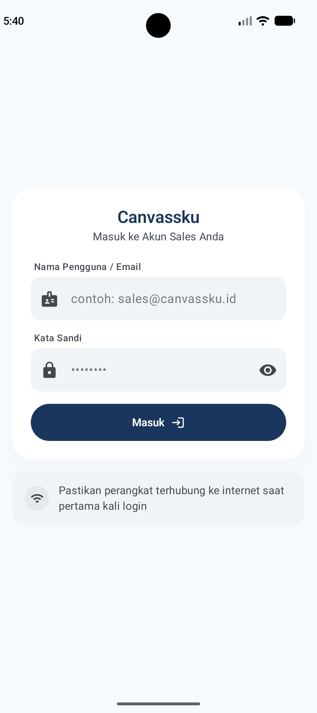
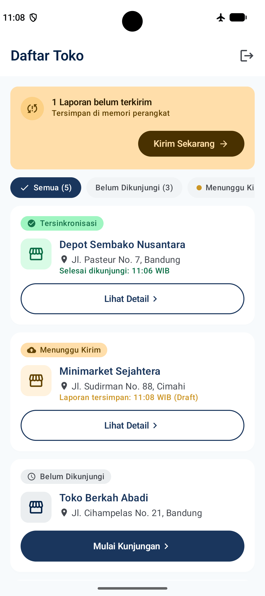
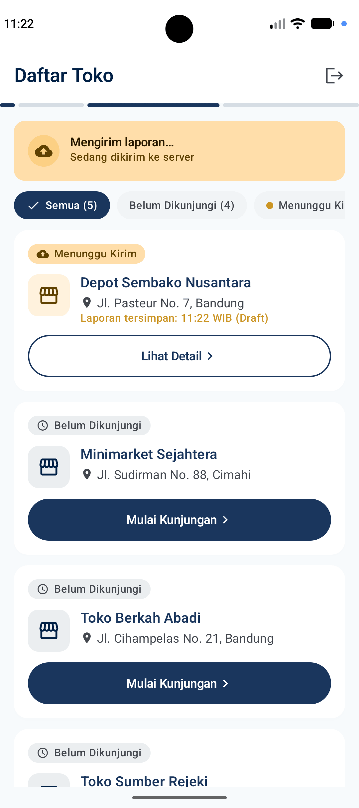
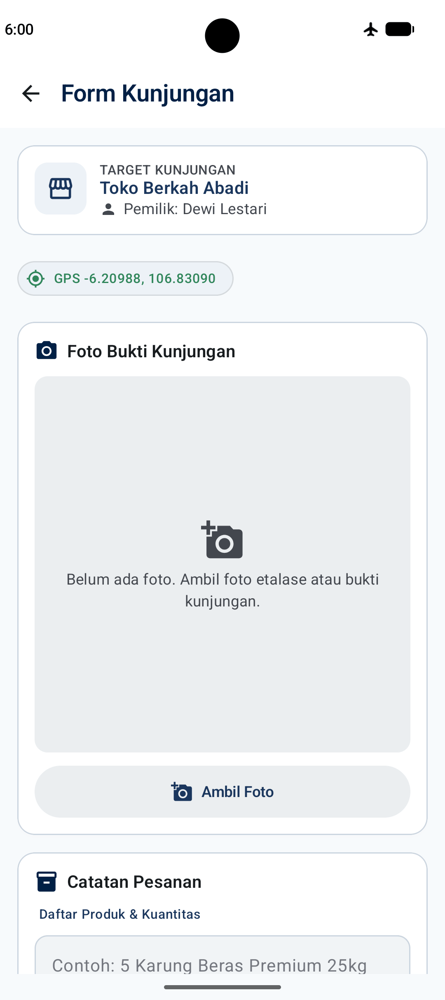
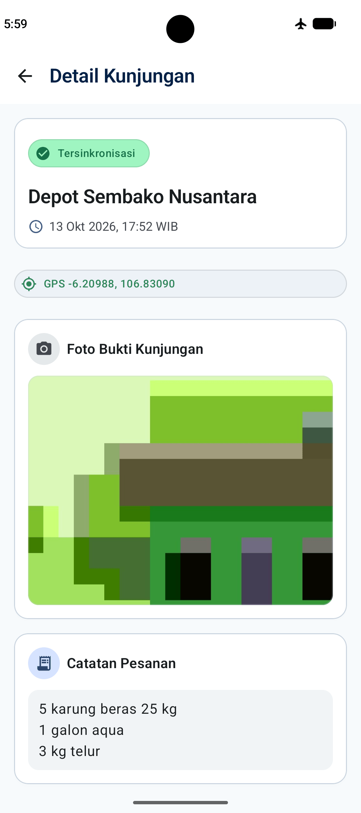

# Canvassku

Canvassku is an offline-first sales canvassing app for field agents who work where the network drops often or never shows up. Visit reports are saved on the device first. When connectivity returns, WorkManager uploads them in the background.

UI copy and sample store data are written in Bahasa Indonesia to match local FMCG field vocabulary.

## Visual Preview

| Login | Home | Syncing | Visit Form | Visit Detail |
| :---: | :---: | :---: | :---: | :---: |
|  |  |  |  |  |

## Core Features

- Offline-first storage with Room as the single source of truth
- Background sync of pending visit reports via WorkManager
- GPS check-in and camera capture for visit evidence
- Silent JWT refresh on HTTP 401 (5-minute access tokens)
- Material 3 UI built from the design tokens in `specs/DESIGN.md`

## Quick Start

### 1. Start Strapi

```bash
cd backend
npm install
npm run develop
```

Admin panel: [http://localhost:1337/admin](http://localhost:1337/admin)

API base URL: `http://localhost:1337/api`

### 2. Run the Android app

1. Open the `android/` project in Android Studio.
2. Wait for Gradle sync to finish.
3. Run the app on an emulator or device that can reach the Strapi host (use `10.0.2.2` for the Android emulator loopback to the host machine).
4. Grant `ACCESS_LOCAL_NETWORK` when prompted (required on targetSdk 37+ to reach a local Strapi API).

## Seed Credentials

| Role | Email | Password |
| --- | --- | --- |
| Strapi Admin | `admin@mail.test` | `admin123!` |
| Mobile App | `budi@mail.test` | `sales123!` |

These accounts are created automatically on `npm run develop` by the bootstrap in `backend/src/index.ts`. Local SQLite files are not committed.

## Documentation

| Document | Contents |
| --- | --- |
| [Development Workflow](docs/DEVELOPMENT_WORKFLOW.md) | Spec-driven AI build, AI + manual review, tests, and field QA |
| [Android README](android/README.md) | Architecture, package layout, auth/sync details, and tests |
| [Backend README](backend/README.md) | Strapi setup, seeding, schemas, and JWT config |

Product and engineering rules live under [`specs/`](specs/).

## Scope Boundaries

- Home shows one visit path per store from the latest report: unvisited opens the form; visited opens detail.
- The store list is seeded after login only; there is no manual store refresh on Home.
- Pending uploads retry from the Home banner (`Kirim Sekarang`).
- This MVP covers sequential field capture and offline upload, not visit history timelines or route optimization.
